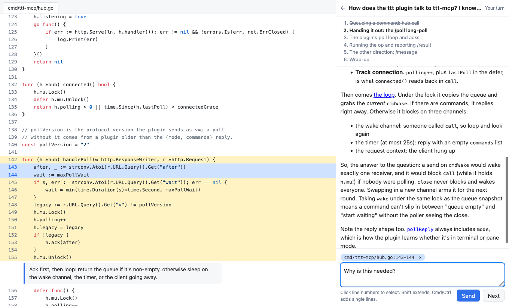

# pedagogue

Ask to have something explained and get a page where a tutor walks you through
it. The tutor is an AI agent that reads your code, opens the files that matter
with the important lines highlighted, draws diagrams, and asks you questions.
You reply, select lines to ask about, and answer quizzes on the same page.



## What a tour gives you

- **A route, not a file listing.** The tutor reads the code first, then sets
  an outline that follows how the thing works and takes it one step at a time.
- **Code panes it controls.** Each step opens a file, highlights the lines to
  look at, and attaches a short note. Line references in the tutor's replies
  are links that bring those lines into view.
- **Questions about what you see.** Click line numbers to select a range or a
  set of separate lines; the selection goes to the tutor with your message.
- **Quizzes.** Multiple choice or free text, checked by the tutor, which asks
  how you got to a wrong answer before correcting it.
- **Diagrams and more.** Mermaid diagrams, markdown tables, and sandboxed HTML
  for anything else worth drawing.
- **Tours that last.** Tours are saved, listed, and resumed where you left
  off, including after a restart.

## How it works

```
your agent session --"explain X"--> tour (skill + CLI) --> daemon --> tutor agent
                                                             |
your browser  <------------ panes, conversation -------------+
```

One daemon runs on the machine that holds your code. It serves the pages and
runs one tutor per tour through the
[Claude Agent SDK](https://code.claude.com/docs/en/agent-sdk/overview). A tutor
can read the directory it is explaining and nothing else. Your browser can be
on another machine.

## Requirements

- Node 22.18 or later and pnpm. With [mise](https://mise.jdx.dev),
  `mise install` gets the versions this repository pins.
- An Anthropic API key. Tutors run on it and usage is billed to it; a tutor
  reads a fair amount of code with a large model, so a tour is not free.
- macOS or Linux. Developed on macOS; used with Safari and Firefox.

## Quick start

```sh
git clone https://github.com/aahoughton/pedagogue && cd pedagogue
pnpm install
mkdir -p ~/.config/pedagogue
install -m 600 env.example ~/.config/pedagogue/env   # then add your API key
pnpm start
```

Open <http://127.0.0.1:4270>, give it a directory and a question, and the tour
opens.

## Starting tours

**From the index page.** Fill in the form.

**From a terminal.** `bin/tour` prints the tour's link:

```sh
bin/tour --cwd ~/src/project "How does config loading work?"
```

**From an agent session.** With the skill installed, "walk me through how X
works" makes the agent write a brief for the tutor, start the tour, and hand
you the link. For Claude Code, link the skill and the launcher from your
checkout:

```sh
ln -s "$(pwd)/skills/guided-explanation" ~/.claude/skills/guided-explanation
ln -s "$(pwd)/bin/tour" ~/.local/bin/tour    # any directory on your PATH
```

## On the tour page

| To                               | Do                                                |
| -------------------------------- | ------------------------------------------------- |
| Move on                          | **Next**, or Cmd/Ctrl+Enter                       |
| Ask or answer                    | Type and press Enter (Shift+Enter for a new line) |
| Select one line                  | Click its number                                  |
| Select a range                   | Drag over line numbers, or Shift-click            |
| Select separate lines            | Cmd/Ctrl-click                                    |
| Jump to lines the tutor mentions | Click the link in its reply                       |
| Stop the tutor mid-reply         | **Stop**                                          |

You can type while the tutor is working; it reads your message after the turn
in progress.

## Using it from another machine

The daemon listens on loopback only unless told otherwise. To open tours from
a laptop while the daemon runs on a desktop, put both on a private network
such as a tailnet and set, in `~/.config/pedagogue/env`:

```sh
PEDAGOGUE_HOST=127.0.0.1,100.x.y.z                      # add the tailnet address
PEDAGOGUE_PUBLIC_URL=http://desk.your-tailnet.ts.net:4270   # what links look like
```

The daemon has no login. Read [SECURITY.md](SECURITY.md) before listening on
anything but loopback.

## Configuration

Settings are read from `~/.config/pedagogue/env` (mode 600; it holds the key),
then from the environment, which wins.

| Variable                 | Default                      | Meaning                                                                             |
| ------------------------ | ---------------------------- | ----------------------------------------------------------------------------------- |
| `ANTHROPIC_API_KEY`      | required                     | The key tutors run on                                                               |
| `PEDAGOGUE_HOST`         | `127.0.0.1`                  | Comma-separated addresses to listen on                                              |
| `PEDAGOGUE_PORT`         | `4270`                       | Port                                                                                |
| `PEDAGOGUE_PUBLIC_URL`   | `http://<first host>:<port>` | Base of the links handed out                                                        |
| `PEDAGOGUE_DATA_DIR`     | `~/.local/share/pedagogue`   | Saved tours and tutor scratch files                                                 |
| `PEDAGOGUE_IDLE_MINUTES` | `15`                         | How long a tutor waits for you before its process stops; your next message wakes it |
| `PEDAGOGUE_MODEL`        | the Agent SDK's default      | Model for tutors                                                                    |
| `PEDAGOGUE_URL`          | `http://127.0.0.1:4270`      | Where `bin/tour` finds the daemon                                                   |
| `PEDAGOGUE_ENV_FILE`     | `~/.config/pedagogue/env`    | A different settings file                                                           |

To start the daemon at login on macOS, see [docs/launchd.md](docs/launchd.md).

## Status

Version 0.9.0. It is a personal tool that works well for its author and is
shared as it is.

- Tutors are Claude only.
- A tour explains one directory, read-only. The tutor cannot run code, and
  there are no writing exercises yet.
- There is no login and no multi-user support.
- Not published to a package registry; run it from a checkout.

## Development

```sh
pnpm test        # node's test runner; no API key needed
pnpm typecheck
pnpm lint        # biome
pnpm format
```

TypeScript runs directly on Node and the browser code is plain modules, so
there is no build step. [AGENTS.md](AGENTS.md) has the conventions.

## License

[MIT](LICENSE)
